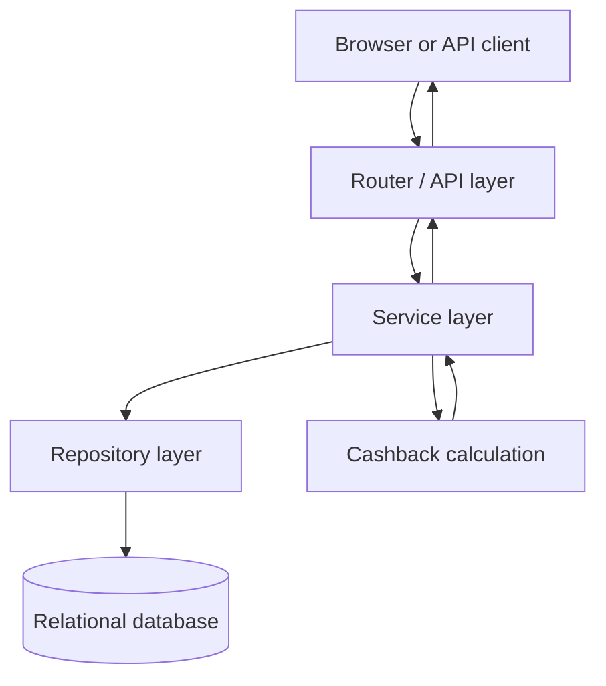

# Architecture Design

| Layer | Responsibility | Examples |
|---|---|---|
| Router/API | HTTP input, validation, auth dependency, response | auth, wallet, merchants, payments |
| Service | Business use-case coordination | PaymentService, cashback calculation, reconciliation |
| Repository | Database queries and persistence | wallet, merchant, cashback, transaction queries |
| Model/Database | Entity definitions, keys, constraints and storage | User, Wallet, Merchant, CashbackRule, Transaction |

## Payment data flow
1. Client sends an authenticated payment request.
2. Router validates payload and identifies the user.
3. PaymentService checks idempotency, wallet, merchant, balance and rule.
4. Cashback function calculates raw cashback and tier-adjusted cap.
5. Repository retrieves this month's cashback already earned.
6. Service applies the remaining cap.
7. One database transaction updates wallet balance and inserts transaction.
8. API returns transaction ID, cashback, balance and replay status.

## Authentication and TalentHub reference
The provided TalentHub code uses JWT Bearer authentication and role claims. This project follows the same broad pattern in a separate module; it does not import TalentHub files or reuse its development secret. Configure a private secret in `.env`.
