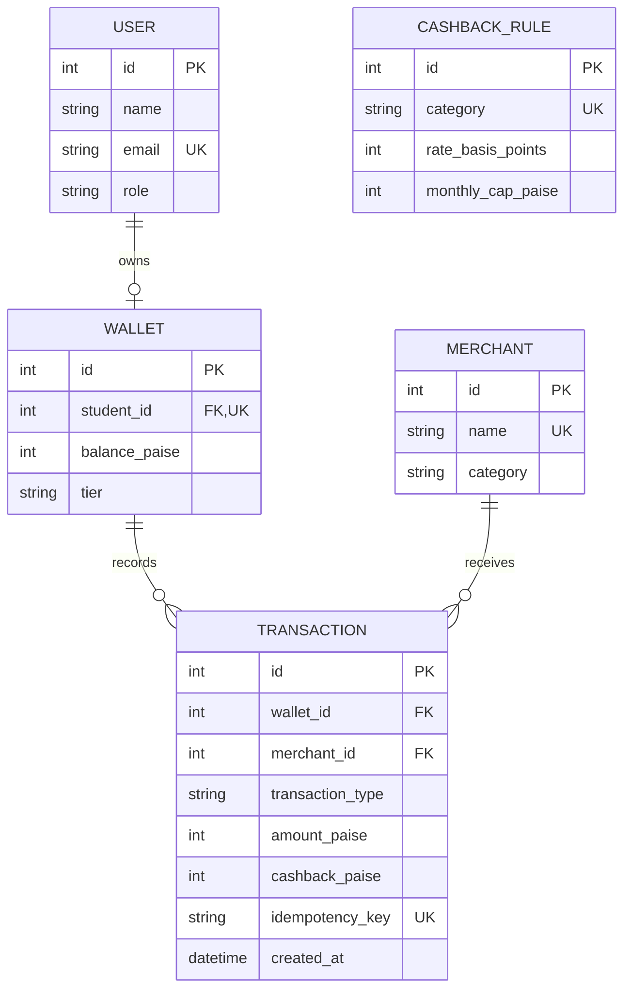

# Database Design

## Entities
- **User:** login identity, email, password hash and role.
- **Wallet:** one wallet per student; balance in paise and tier.
- **Merchant:** merchant name, category and active status.
- **CashbackRule:** one cashback rate and monthly cap per category.
- **Transaction:** payment/top-up record, amount, cashback, idempotency key, status and timestamp.

## ER diagram

CashbackRule is matched through the category. A rule-version foreign key is a possible future extension for audit history.

## Keys, relationships and normalization
- Wallet.student_id is a unique foreign key to User.
- Transaction.wallet_id references Wallet.
- Transaction.merchant_id references Merchant and is nullable for top-ups.
- Transaction.idempotency_key is unique.
- User, wallet, merchant and cashback rule facts are stored separately, avoiding repeated merchant/user details in transaction rows.
- The schema is broadly normalized for this MVP. Transaction retains the category used at payment time for historical reporting.

## Money
₹125.50 is stored as 12550 paise. Integer storage avoids binary floating-point rounding errors.
